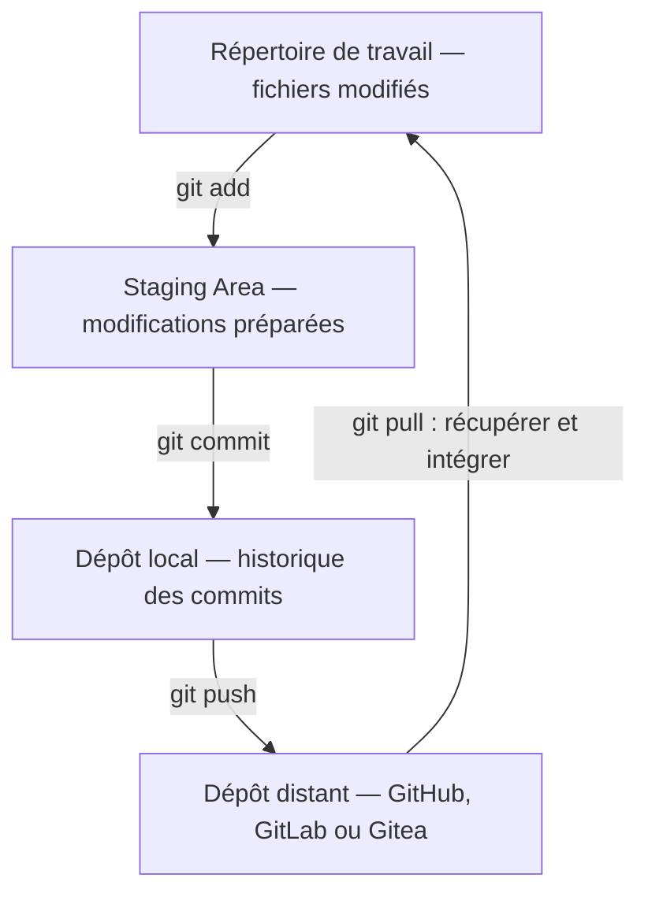

# Git — Concepts

Cette partie reprend les notions que j’ai apprises sur KodeKloud. Pour chaque notion, nous allons voir à quoi elle sert et les points à retenir pour son utilisation.

Les commandes correspondantes sont regroupées dans [commandes.md](commandes.md).

## 1. Fonctionnement de Git

Git est un système de gestion de versions. Il permet de suivre les modifications des fichiers, de conserver les anciennes versions et de travailler à plusieurs sur un même projet.

Il faut bien différencier Git de GitHub : Git est l’outil utilisé pour gérer les versions, alors que GitHub, GitLab et Gitea sont des plateformes d’hébergement de dépôts.

### Les trois zones

| Zone | Description |
| --- | --- |
| Working Directory | Répertoire de travail contenant les fichiers que nous modifions. |
| Staging Area | Zone de préparation contenant les modifications sélectionnées avec `git add`. |
| Local Repository | Dépôt local contenant l’historique des commits, stocké dans le dossier `.git`. |

Lorsque nous modifions un fichier, les changements se trouvent dans le répertoire de travail. Nous utilisons ensuite `git add` pour les préparer, puis `git commit` pour enregistrer un état du projet dans l’historique local.

Si le fichier est modifié après le `git add`, il faudra refaire cette commande pour prendre en compte les dernières modifications dans le prochain commit.

### Les échanges entre les zones

Pour un nouveau projet, nous utilisons `git init` afin de créer le dépôt local. Si nous récupérons un dépôt existant avec `git clone`, cette initialisation est déjà faite.

Une fois le dépôt créé, voici comment circulent les modifications :

Nous utilisons `git add` pour préparer les modifications, puis `git commit` pour les enregistrer localement. Avec `git push`, nous envoyons les commits vers le dépôt distant, qui doit être configuré.

Dans l’autre sens, `git pull` récupère les changements distants et les intègre à notre branche locale. La flèche vers le répertoire de travail représente le résultat de cette intégration : le dépôt local est également mis à jour. Il ne s’agit donc pas d’une simple copie de fichiers.

### HEAD

`HEAD` représente notre position actuelle dans l’historique. Il pointe généralement vers la branche sur laquelle nous travaillons et permet ainsi de retrouver son dernier commit.

### Le fichier .gitignore

Le fichier `.gitignore` permet d’indiquer les fichiers ou dossiers que nous ne souhaitons pas suivre avec Git.

Cela ne concerne que les fichiers qui ne sont pas déjà suivis. Ajouter un fichier déjà versionné dans `.gitignore` ne suffit donc pas à arrêter son suivi.

## 2. Branches et merge

Une branche permet de travailler sur une fonctionnalité ou une modification séparément de la branche principale, généralement appelée `main` ou `master`.

Une fois les modifications terminées, nous pouvons les intégrer à une autre branche avec un merge.

Par exemple, pour intégrer une branche `feature` dans `main`, il faut d’abord se placer sur `main`, puis lancer `git merge feature`. La fusion se fait donc dans la branche sur laquelle nous sommes positionnés.

### Checkout ou switch

Pour changer de branche, nous pouvons utiliser `git checkout` ou `git switch`.

| Besoin | Avec checkout | Avec switch |
| --- | --- | --- |
| Aller sur une branche existante | `git checkout feature` | `git switch feature` |
| Créer une branche et aller dessus | `git checkout -b feature` | `git switch -c feature` |

Les deux permettent ici d’obtenir le même résultat. `git switch` est dédié au changement de branche, alors que `git checkout` possède aussi d’autres usages.

### Conflits de fusion

Un conflit apparaît lorsque Git ne peut pas fusionner automatiquement les modifications. Il faut alors ouvrir les fichiers concernés, corriger le contenu et retirer les marqueurs de conflit.

Une fois les corrections effectuées, nous utilisons `git add` pour préparer les fichiers, puis `git commit` pour terminer la fusion.

## 3. Dépôts distants et collaboration

Un dépôt distant est un dépôt partagé, hébergé par exemple sur GitHub, GitLab ou Gitea. Il permet d’envoyer son travail et de récupérer celui des autres contributeurs.

| Notion | Rôle |
| --- | --- |
| Clone | Copier un dépôt distant en local. |
| Push | Envoyer les commits locaux vers le dépôt distant. |
| Fetch | Récupérer les changements distants sans les intégrer à la branche courante. |
| Pull | Récupérer les changements distants et les intégrer à la branche courante. |

La différence entre `fetch` et `pull` est donc l’intégration des changements. Avec `fetch`, nous récupérons les informations sans modifier directement notre branche de travail. Avec `pull`, nous récupérons et intégrons les changements, par fusion ou rebase selon les options et la configuration.

### Origin et upstream

`origin` est le nom conventionnel du dépôt distant principal. Il est configuré automatiquement lorsque nous clonons un dépôt.

Dans le cas d’un fork :

- `origin` correspond généralement à notre fork, si c’est celui que nous avons cloné.
- `upstream` correspond au dépôt original, si nous l’avons ajouté à la configuration.

### Fork

Un fork est une copie d’un dépôt sur son propre compte. Cela permet notamment de contribuer à un projet sans avoir directement les droits d’écriture sur le dépôt original.

### Pull Request

Une Pull Request permet de proposer la fusion d’une branche et de faire vérifier les modifications avant leur intégration.

Nous créons une branche, enregistrons les modifications avec des commits, puis envoyons cette branche sur le dépôt distant. Nous pouvons ensuite ouvrir une Pull Request sur la plateforme pour demander une revue avant la fusion.

## 4. Rebase et cherry-pick

### Rebase

Le rebase permet de rejouer les commits d’une branche sur une nouvelle base. Il est utile pour obtenir un historique plus linéaire.

Avec `git rebase main` depuis la branche `feature`, les commits propres à `feature` sont rejoués à partir de la version locale de `main`.

### Rebase interactif

Le rebase interactif permet de modifier ou de nettoyer plusieurs commits. Nous pouvons conserver un commit, modifier son message, le regrouper avec un autre ou le supprimer de l’historique rejoué.

| Option | Rôle |
| --- | --- |
| `pick` | Garder le commit. |
| `reword` | Modifier son message. |
| `squash` | Regrouper le commit avec le précédent dans la liste. |
| `drop` | Supprimer le commit de l’historique rejoué. |

Attention : le rebase réécrit les commits concernés. Il faut donc éviter de rebaser des commits déjà partagés avec d’autres personnes sans se coordonner avec elles.

### Cherry-pick

Le cherry-pick permet de reprendre les modifications d’un commit précis sur la branche actuelle, sans fusionner toute la branche d’origine.

| Opération | À retenir |
| --- | --- |
| Merge | Fusionner les historiques. |
| Rebase | Rejouer les commits sur une nouvelle base. |
| Cherry-pick | Reprendre les modifications d’un commit précis. |

## 5. Reset et revert

### Reset

Le reset permet de revenir à un ancien commit en déplaçant le pointeur de la branche. Son effet sur les modifications dépend de l’option utilisée.

Pour revenir au commit précédent :

| Option | Effet |
| --- | --- |
| `--soft` | Retire le dernier commit de la branche et conserve les modifications dans la Staging Area. |
| `--mixed` | Retire le dernier commit de la branche et conserve les modifications dans les fichiers, hors de la Staging Area. |
| `--hard` | Remet l’index et les fichiers suivis à l’état du commit ciblé. Les modifications locales concernées sont perdues. |

Attention : `--hard` peut entraîner une perte de travail. Il faut vérifier ce que nous souhaitons conserver avant de l’utiliser.

### Revert

Le revert permet d’annuler les modifications d’un commit en créant un nouveau commit. Le commit d’origine reste présent dans l’historique.

La différence principale est donc que `reset` modifie la position de la branche, alors que `revert` ajoute un commit d’annulation. Pour un commit déjà partagé, il est préférable d’utiliser `revert`.

## 6. Stash

Le stash permet de mettre temporairement ses modifications de côté sans faire de commit sur la branche. C’est utile lorsque nous devons changer de branche alors que notre travail n’est pas terminé.

Par défaut, `git stash` prend en compte les modifications des fichiers suivis. Pour inclure également les nouveaux fichiers non suivis, nous utilisons `git stash -u`. Les fichiers ignorés ne sont pas inclus avec cette option.

Pour reprendre le travail :

- `git stash apply` restaure les modifications et conserve le stash.
- `git stash pop` restaure les modifications et retire le stash si l’application réussit.

L’application d’un stash peut provoquer des conflits. Si `pop` rencontre un conflit, le stash est conservé.

## 7. Reflog

Le reflog permet de retrouver les anciennes positions de `HEAD`, notamment après un reset ou un rebase.

Il peut ainsi aider à retrouver un commit qui n’apparaît plus dans l’historique de la branche. Cette récupération reste possible tant que le commit est encore disponible dans le dépôt local.

## À retenir

- `add`, `commit` et `push` correspondent à trois actions différentes : préparer, enregistrer localement et envoyer.
- Une branche permet de travailler séparément avant de fusionner les modifications.
- Une Pull Request permet de proposer une fusion et de faire relire le travail.
- `reset`, `revert` et `stash` répondent à des besoins différents : revenir en arrière, annuler un commit ou mettre temporairement le travail de côté.

[Retour au README](README.md) · [Consulter les commandes](commandes.md)
